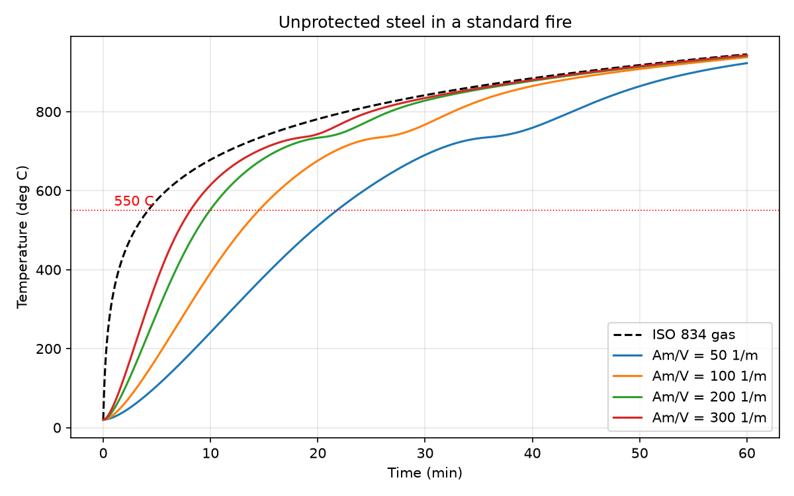

# Steel temperature in a standard fire

How fast does unprotected structural steel heat up when a building burns? This script follows the simplified method in Eurocode 3 (EN 1993-1-2, section 4.2.5.1) and plots the result for four section factors.



## Run it

```
python3 -m venv .venv
source .venv/bin/activate
pip install -r requirements.txt
python steel_fire.py
python test_steel_fire.py
```

## What it does

- Gas temperature follows the ISO 834 standard fire curve: `20 + 345 log10(8t + 1)`, t in minutes.
- The steel section is one lump at one temperature. Each 2-second step, convection and radiation from the gas heat it, and the steel's specific heat decides how much the temperature rises.
- Specific heat changes with temperature, including the bump near 735 C where the steel changes phase. That bump is the flat spot in the curves.
- Section factor Am/V (heated surface per unit volume, 1/m) is the main input. Slender sections heat fast, heavy ones slowly.

Results for the time to reach 550 C, a commonly used critical temperature:

| Am/V (1/m) | Minutes |
|---|---|
| 50 | 21.8 |
| 100 | 14.5 |
| 200 | 9.9 |
| 300 | 8.1 |

## Limits

This is a learning project, not a design tool.

- No shadow effect correction (the factor `ks,h` is taken as 1).
- One uniform temperature per section, no gradients.
- Unprotected steel only. No insulation, no concrete, no real fire compartment.
- Standard fire only, not a natural fire with a cooling phase.
- Formulas typed in from EN 1993-1-2 and checked with the small tests in `test_steel_fire.py`. I haven't yet compared the output against a published worked example. That is the next step.

## Next

- Compare against a worked example from the Eurocode or a textbook.
- Add protected steel.
- Natural fire curves with a cooling phase.
- Thermal-mechanical finite element model of a single member.
